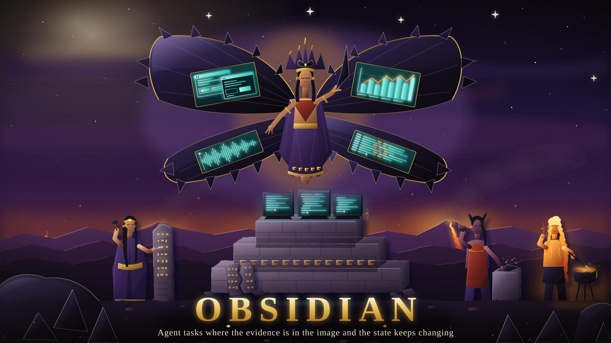
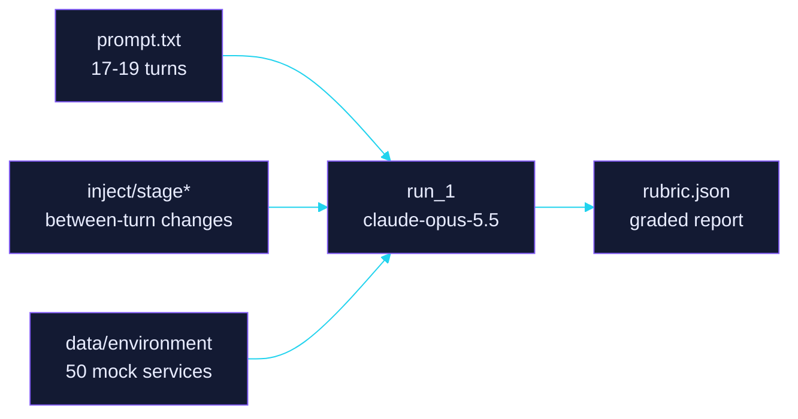

<p align="center"></p>

# Obsidian: samples

<p align="center"><b>The samples lane: 5 multi-turn task bundles, one shipped trajectory each.</b></p>

<p align="center"><a href="#bundles"></a> <a href="#bundles"></a> <a href="#evidence-status"></a></p>

<p align="center"><sub><a href="#abstract">Abstract</a> | <a href="#summary">Summary</a> | <a href="#bundles">Bundles</a> | <a href="#evidence-status">Evidence status</a> | <a href="#dataset-structure">Dataset structure</a> | <a href="#verification-and-quality-assurance">Verification and quality assurance</a> | <a href="#reproduction">Reproduction</a> | <a href="#cite">Cite</a> | <a href="#license">License</a> | <a href="#contact">Contact</a></sub></p>

## Abstract

Five multi-turn agent tasks in the obsidian format. Each bundle is one persona's working week: a conversation of 17
to 19 turns, a world of 50 mock services that changes between turns, and a rubric graded on what the agent says,
writes and leaves behind. Each directory is named by the bundle's delivery uuid and ships exactly one graded
trajectory.

## Summary

| Property | Value |
| --- | --- |
| Bundles | 5 |
| Trajectories | 1 per bundle (`run_1`), `pass_at_k = 1` |
| Model | `claude-opus-5.5` |
| Harness | obsidian-harness 2a85015, agent image `wildclawbench-ubuntu:v1.5` |
| Grading | rubric only; no `tests/` |
| Sealed | 0 of 5 |

## Bundles

| Bundle | Persona | Task | Turns | Inject stages | Rubric items (positive points, penalties) | Shipped run |
| --- | --- | --- | --- | --- | --- | --- |
| `274f30a4-fc11-47de-92dc-415922a77456` | Ryan Mitchell | cohort close week | 19 | 9 | 46 (55, 5) | 58.18% |
| `9bfe4521-2033-41a1-ac6a-e9ba776fd372` | Reggie Clayton | shop close week | 18 | 9 | 45 (54, 5) | 61.11% |
| `743883a7-eb02-4d23-9e31-b30dc3d5d431` | Brittany Morales | stellar listing launch | 17 | 10 | 42 (74, 4) | 54.05% |
| `5c0a7d73-a816-4866-8450-c3970d4e0257` | Jessica Wright | pemberton living room | 19 | 8 | 80 (110, 6) | 64.55% |
| `c255ef1b-199d-4a60-a6ca-37964ca77722` | Margaret Edwards | still waters delivery week | 17 | 10 | 70 (95, 7) | 50.53% |

The persona-prefixed task id stays inside each bundle, in `mock_modules.json` and the `prompt.txt` header.

## Evidence status

None of the five is sealed yet. They were authored with FORGE as client-format drafts, and FORGE seals a draft only
after a format run on the host, which waits on
[EtharaLabs/trinity#606](https://github.com/EtharaLabs/trinity/issues/606). Until then no audit verdict is recorded for
them, and their directory names are delivery uuids rather than FORGE's content-derived uuid5. Each bundle carries its
grading key under `data/solution/`, so this repository stays private.

## Dataset structure

```
<uuid>/
├── prompt.txt              the conversation, turn by turn (header: task id, persona, timezone, window, turns)
├── rubric.json             graded items, positive and penalty
├── mock_modules.json       digests of the mock service modules the task runs on
├── inject/
│   └── stage<N>/           the world change applied between two turns
│       ├── mutations.json  silent, loud and filesystem mutations with their timing
│       └── files/          filesystem payloads (photos, scans) the mutations deliver
├── data/
│   ├── task.toml           runner manifest (pass_at_k = 1)
│   ├── instruction.md      the conversation as the runner reads it
│   ├── environment/        Dockerfile and compose files, shared mock modules, 50 *-api services,
│   │                       persona/ (the agent's standing files), skills/, tools-gateway/,
│   │                       artifacts/inputs/ (the home folder the agent starts with)
│   └── solution/           TRUTH.md (grading key) and solve.sh
└── trajectories/
    └── claude-opus-5.5/
        ├── pass_summary.json
        └── run_1/          the shipped run: output.json, report.json, usage.json, output_media/
```



## Verification and quality assurance

Before it was pushed, every bundle passed:
- the client QC (`process_vendor_data`): validation, Tier 1 and the Tier 2 review (A, B, C, D, N3), with only the
  validator's two known false positives;
- the obsidian integrity checker: HARD-clean, 5 of 5, with the shared harness files identical across all five;
- neo-qc: Tier 1, 1.5 and 2.5 without a fail, TRUTH coverage without a gap, and an all-criteria re-grade that agrees
  on every item.

## Reproduction

Each bundle is self-contained for obsidian-harness 2a85015: `data/task.toml` is the runner manifest,
`data/environment/` the sandbox and its mock services, `inject/` the changes between turns, and `rubric.json` the
grading. `trajectories/claude-opus-5.5/run_1/` holds the shipped run and its graded report.

## Cite

```bibtex
@misc{obsidian2026,
  title        = {Obsidian: Multimodal, Multi-Turn Agent Tasks with Measured Difficulty},
  author       = {{Ethara.AI}},
  year         = {2026},
  howpublished = {\url{https://github.com/Ethara-Ai/obsidian}}
}
```

## License

Released under the MIT License, `Copyright (c) 2026 Ethara.AI`. See [LICENSE](LICENSE).

## Contact

- Organization: <https://github.com/Ethara-Ai>
- Security: see [SECURITY.md](SECURITY.md) or write to <security@ethara.ai>
- Contributing: see [CONTRIBUTING.md](CONTRIBUTING.md)

Copyright (c) 2026 Green Rider Technology LLP (Ethara AI). All rights reserved.
